<!-- BANNER - terminal profile.sh --live (additive). Generated by scripts/banner/generate.py.
     Cache-bust with ?v=N after regenerating. -->
<picture>
  <source media="(prefers-color-scheme: dark)"  srcset="assets/banner-dark.v9.svg">
  <source media="(prefers-color-scheme: light)" srcset="assets/banner-light.v9.svg">
  
</picture>

 

<!-- NAME / TAGLINE - animated typing -->

 

<!-- SOCIALS -->
&nbsp;&nbsp;

 

---

## I'm this ッっ

Hi, I'm **Elian**, full-stack developer and software engineering student, broadcasting from Veracruz, México 🇲🇽.
I build full-stack applications, deploy them on AWS and plug AI into them so real people can actually use them.

- 🎓 **Software Engineering student** at Universidad Tecnológica del Centro de Veracruz — *Ingeniería en Desarrollo y Gestión de Software* (2025 – presente).
- 💼 **Software Developer Intern at 7D Construction** (Chicago): built a responsive web app, migrated manual Excel workflows to the cloud and ran the production environment on **AWS EC2**, improving field-to-office communication by **84%**.
- 🏆 **AutiSense** — AI-powered screening platform for early autism detection in infants. Awarded the **state pass at ExpoCiencias Xalapa 2026**.
- 🏋️ **Osmio** — full-stack sports & nutrition tracker with automated progressive-overload and dynamic macronutrient algorithms.
- ☁️ **AWS certified** (DevOps + Lambda) and currently deep into **AI agents** through the **Model Context Protocol (MCP)**.
- 💬 Talk to me about **full-stack, AWS or applied AI** and you'll have my full attention.

 

## my perfect stack

---

## signals

<table>
<tr>
<td width="50%" align="center" valign="middle">

<!-- Self-rated radar - edit assets/skills.json, then rerun scripts/radar.py -->
<picture>
  <source media="(prefers-color-scheme: dark)"  srcset="assets/radar-dark.svg">
  <source media="(prefers-color-scheme: light)" srcset="assets/radar-light.svg">
  
</picture>

</td>
<td width="50%" align="center" valign="middle">

<!-- Hand-authored language stack radar - edit assets/langmix.json -->
<picture>
  <source media="(prefers-color-scheme: dark)"  srcset="assets/radar-langs-dark.svg">
  <source media="(prefers-color-scheme: light)" srcset="assets/radar-langs-light.svg">
  
</picture>

</td>
</tr>
</table>

---

## things I've shipped

<table>
<tr>
<td width="50%" valign="top">

### 🏆 AutiSense
AI web platform for early autism detection in infants.
End-to-end data pipelines and interactive clinical data collection.

`Python` · `AI/ML` · `REST APIs`

</td>
<td width="50%" valign="top">

### 🏋️ Osmio
Full-stack sports & nutrition tracker.
Automated load progression plus a dynamic macronutrient calculator.

`React` · `Node.js` · `Full-Stack`

</td>
</tr>
<tr>
<td width="50%" valign="top">

### 🏗️ 7D Construction
Cloud platform that replaced manual Excel workflows.
Responsive web app on AWS EC2 for field and office teams.

`AWS EC2` · `Responsive Web` · `REST APIs`

</td>
<td width="50%" valign="top">

### 📜 Certifications
DevOps on AWS · AWS Lambda Foundations · Cisco Switching, Routing & Wireless Essentials · Intro to Model Context Protocol (MCP).

`AWS` · `Cisco` · `Claude Academy`

</td>
</tr>
</table>

---

` Build with love · @ElianMC3 `

